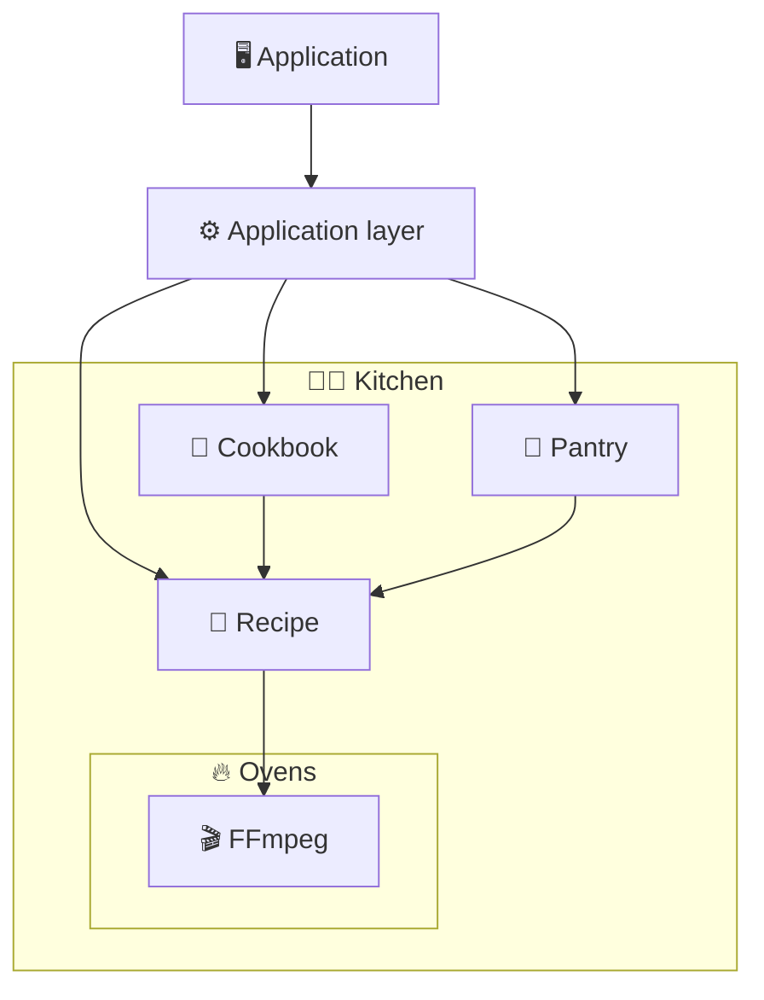
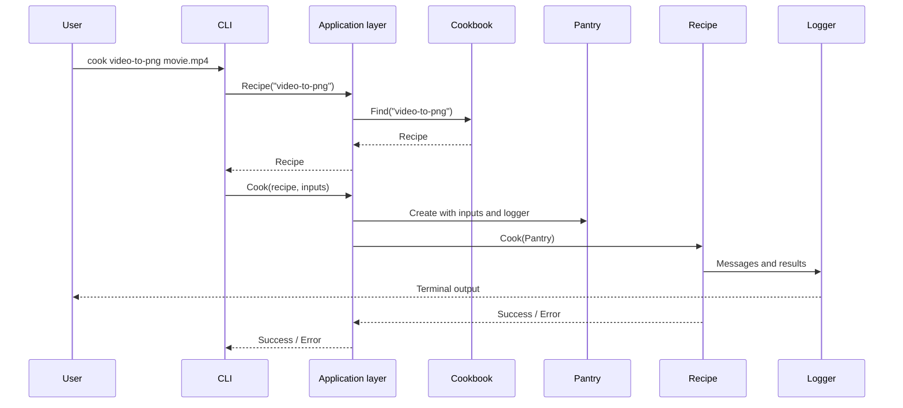

# Architecture

FFrecipes is designed as a set of components. They each have a single responsibility and communicate with the others through well-defined interfaces. This separation makes it easier to test components independently and allows the application to evolve (for example from a CLI to a graphical interface) without changing the recipes themselves.

## Components overview

The Application is the entry point between the user and FFrecipes. It currently uses a CLI, but should later be replaced or complemented by another interface (GUI or TUI). The application layer in `internal/app` owns the shared workflow: recipe lookup, Pantry construction, and execution. The CLI in `cmd/ffrecipes` only parses arguments and presents results, so other frontends can reuse the application layer.

The Kitchen contains the core cooking logic:

- Cookbook manages available recipes;
- Pantry provides recipes with their required resources;
- Recipes tell how to use the resources provided by the Pantry;
- Ovens perform the actual processing work.

Recipes log through the `kitchen.Logger` interface exposed by the Pantry. `internal/ui` provides the current CLI implementation; future TUI or GUI frontends can provide their own without changing recipe code.

## Recipe principles

Every recipe should:

- describe itself;
- perform one focused task;
- be reusable;
- get its inputs through the Pantry;
- communicate to the user through the logger;
- never parse CLI arguments;
- never search for FFmpeg;
- never interact with the user;
- return an error instead of terminating the program;
- register itself in the Cookbook.
